 

## About

 

<i>"Build with purpose. Improve with every commit."</i>

## Stack

## GitHub Insights

### Contribution Snake

## Projects

Explore my repositories for projects, experiments, and development work.

## Connect

