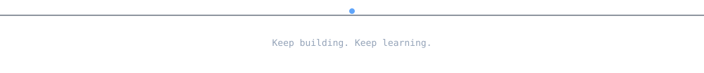

 

## About

 

<i>"Build with purpose. Improve with every commit."</i>

## Stack

## Focus & Selected Work

 

**TowingTask_front** &nbsp;·&nbsp; **Nafis Leather** &nbsp;·&nbsp; **CSeven**  
**OKR** &nbsp;·&nbsp; **FasihiExchangeFront**

 

<a href="https://github.com/MahXari?tab=repositories">View all repositories ↗</a> &nbsp;·&nbsp; <a href="https://github.com/MahXari">GitHub profile</a>

## Connect

